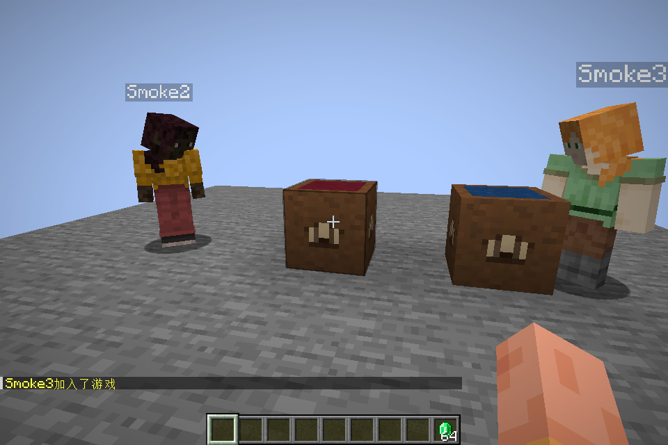
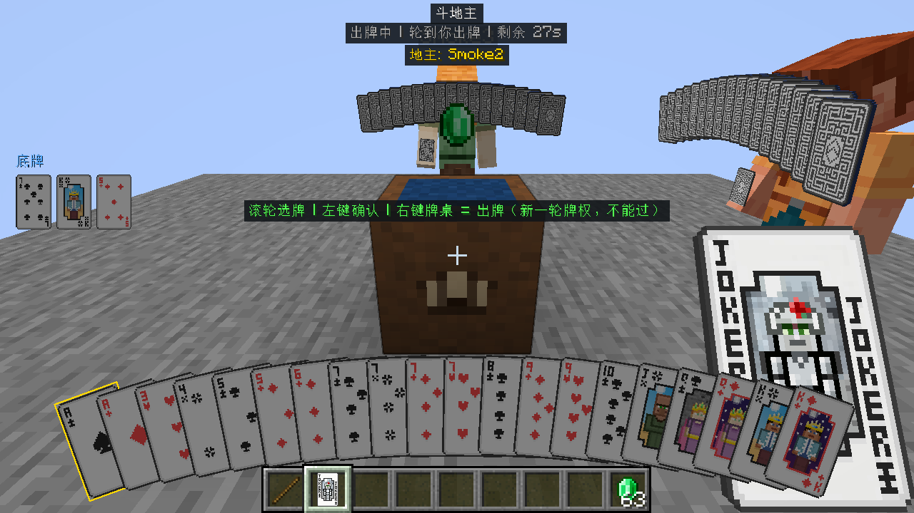
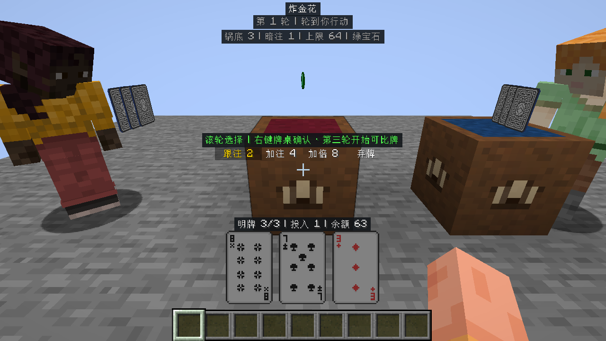
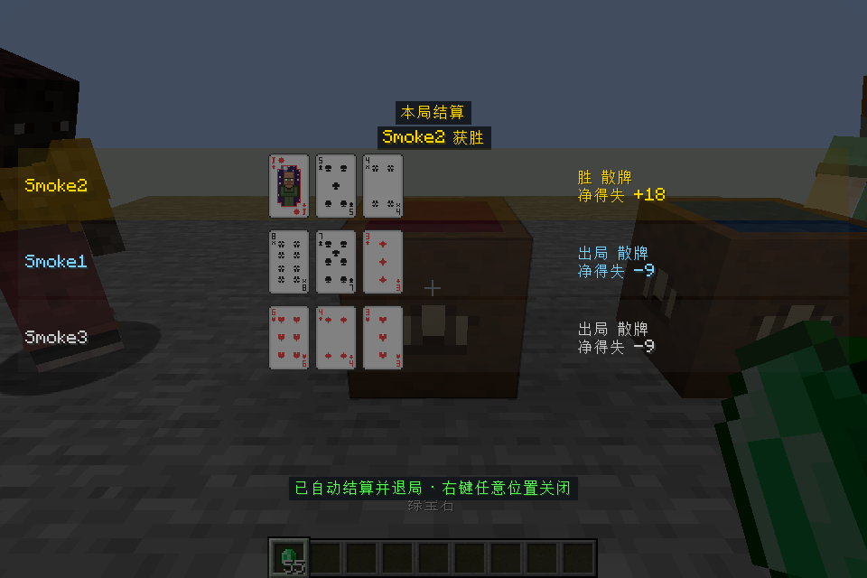

# 斗地主 / 炸金花 HUD 统一与实机测试报告

测试日期：2026-10-21（Asia/Shanghai）。目标：NeoForge 21.1.236 / Minecraft 1.21.1，Java 21.0.11，Windows。

## 结论

本轮已将两种游戏接入同一套设计画布、操作区锚点、模型尺寸换算与底部避让规则，保留各自的手牌排法与玩法。
两个独立的“专用服务器 + 三个真实 Minecraft 客户端”验收均通过。已实际查看并归档29张代表性截图，修正后未发现本轮覆盖场景中的阻塞性排版或操作问题。

| 验证层级 | 本次结果 | 证据 |
|---|---|---|
| 单元测试 | 187项，0失败，0错误 | [原始JUnit XML](evidence/hud-2026-10-21/test-results/) |
| 服务端GameTest | 81项必测全部通过 | [日志](evidence/hud-2026-10-21/hud-review-functional.log) |
| 布局探针 | 24阶段 × 4档GUI尺寸，1356检查，0 FAIL / 0 WARN | [探针报告归档](evidence/hud-2026-10-21/layout-probe-report.md) |
| 斗地主真实联机 | 服务端及3客户端均PASS；正常结算、右键关闭 | [结构化结果](evidence/hud-2026-10-21/ddz-result.json)、[运行日志](evidence/hud-2026-10-21/hud-review-ddz-textures.log) |
| 炸金花真实联机 | 服务端及3客户端均PASS；配置保存、翻牌、跟注、比牌、结算与关闭 | [结构化结果](evidence/hud-2026-10-21/zjh-result.json)、[运行日志](evidence/hud-2026-10-21/hud-review-zjh-textures.log) |
| 逐图视觉复核 | 29张归档实机截图已查看 | [截图图廊](evidence/hud-2026-10-21/index.html)、[复核清单](evidence/hud-2026-10-21/review.json) |
| 安装包构建 | 规定构建脚本成功，并核验目标JAR存在 | [构建日志](evidence/hud-2026-10-21/hud-review-build.log) |

“通过”限于下文明确列出的覆盖范围；未实测场景列在报告末尾。真实客户端使用开发运行环境，本轮没有把发布JAR放进另一套干净实例再验一次。

## 1. 原报告之间究竟有什么不同

用户指定目录 `build/mc-1.21.1/zjh-ui-probe/` 中，`report.md` 与 `index.html` 是同一次炸金花探针的两种输出：前者适合读检查表，后者增加线框图廊。它们不是斗地主与炸金花各自独立运行的一份报告。
原输出中“与斗地主的对照”只比较了部分布局公式，不能当作独立斗地主探针或实机测试。

| 对照项 | 原有斗地主实现 | 原有炸金花实现 | 本轮处理 |
|---|---|---|---|
| 坐标体系 | GUI先换算成320高设计画布 | 直接使用GUI尺寸 | 共用 `CardGameHudLayout.viewport` |
| 操作锚点 | 距设计画布底部165 | 从三张手牌上沿反推 | 共用距底180；在320高画布上为y=140，留出准星空间 |
| 牌高换算 | 完整模型宽10.2、高16 | 以中央牌面宽9计算 | 共用完整模型换算；焦点框与模型尺寸一致 |
| 手牌 | 多张扇形叠放，选中上抬 | 三张平铺，逐张翻开 | 保留玩法差异，共用底部安全区 |
| 结算关闭提示 | 靠近屏幕底部 | y=屏高−14 | 共用设计y=266，避开快捷栏和物品名 |
| 文字可读性 | 世界名牌可能与顶部文字重叠 | 普通文字直接叠在世界上 | 关键文字使用共享局部深色底衬 |

原报告里“操作行相差14/28px”混用了两种坐标空间，不能解释为实机距离差。现在跨游戏表先计算共享画布，再换算回GUI像素，默认操作行差值为0。
另一个校正是“1280×720 + 缩放4一定等于320×180”：本机实测原版约束后的有效GUI为427×240、缩放3。320×180保留为探针压力输入，不写成已实机采集的GUI尺寸。

## 2. 最终固定的布局与风格

正式规范见[《棋牌游戏HUD布局规范 v1》](棋牌游戏HUD布局规范.md)。核心约定如下：

1. 普通对局保持世界叠加HUD，顶部公共局势、中央世界观察空间、本人操作与手牌区、结算遮罩分工固定。
2. 所有牌类游戏先在320高设计画布计算，按窗口宽高比调整画布宽度，再整体缩放。探针与实机遵守同一换算。
3. 标题y=4、阶段y=16、局势y=30；反馈y=114、提示y=127、行动选项y=140，相邻文字基线节奏保持13。
4. 选项等宽、居中、金色焦点；普通文字白色、次要信息灰色、提示绿色、错误红色、本人结算身份浅蓝。文字使用局部深色底衬，保留世界画面。
5. 手牌底部居中，默认底边距30设计像素，同时保证实际GUI至少留26给快捷栏。卡牌完整模型按16/10.2计算缩放。
6. 结算内容居中，关闭提示在设计y=266。两种游戏均支持右键关闭结果，斗地主保留左键关闭兼容行为。
7. 新游戏复用共享画布、排版、颜色语义、模型与安全区；只增加自己的公共字段、行动和手牌排法。隐私、计分及网络协议仍由各玩法独立负责。

## 3. 实机发现并修正的问题

### 各玩法专属桌面

按用户补充要求，斗地主桌面改为深蓝、炸金花改为酒红，两者均不再使用绿色。
各自拥有独立的32×32图集及粒子贴图；炸金花世界模型和物品模型覆盖本游戏材质，木框与侧面图案保留原样。
新增3项资源测试检查世界/物品模型映射及桌布主色，颜色测试先复现失败，替换后完整单测通过。
贴图经内置imagegen生成桌布象限并最近邻采样，提示词与资源路径记录在[贴图文档](牌桌专属贴图.md)。



上图是同一真实世界的并排截图，已查看确认颜色不同、木框完整、桌面无缺失纹理。加入贴图后两套三人联机验收重新运行，最终截图全部更新为这一版本。

### HUD布局修复

| 问题 | 依据 | 修正与回归 |
|---|---|---|
| 相同公式数值在两种游戏里产生不同屏幕比例 | 核对两条实际渲染入口 | 炸金花接入斗地主已有的320高画布；新增跨GUI尺寸锚点测试 |
| 炸金花模型边缘超出布局预算 | 真实截图与 `card_base.json` 完整边界对照 | `CardVisuals` / `ZJHLayout` 共用完整模型宽10.2的换算 |
| 结算关闭提示压住快捷栏 | 查看初轮两种游戏结算截图 | 两种游戏共用54设计像素的底部关闭提示预留 |
| 顶部文字受世界名牌干扰 | 查看斗地主行动者视角 | 增加局部文字底衬，提高对比度 |
| 准星压在行动选项上 | 查看炸金花1280×720与全屏截图 | 操作区由设计y=155上移至140，两个游戏同步；新增准星避让检查 |

模型、原操作锚点与底部提示的3个回归测试先确认失败，再修改实现；准星避让也单独确认过失败后修正。
失败证据保留为 [初轮回归日志](evidence/hud-2026-10-21/hud-review-red.log) 与 [准星回归日志](evidence/hud-2026-10-21/hud-review-crosshair-red.log)。最终完整187项单元测试通过。

同时修正了验收夹具：音乐包目录改为仓库当前的 `learning-soundpacks/官方默认包`，确保配置父目录存在；全屏切换测试中，脚本预设只过牌的农民在操作前明确清空选择，防止预选牌改变脚本策略。
首轮全屏复测因此未通过，未计入最终PASS；修正脚本后，最终独立批次重新完成了普通结算。本轮没有把超时判负冒充正常胜负结算。

## 4. 实际功能覆盖

### 斗地主

真实三客户端经现有交互入口、C2S/S2C与服务端权威引擎完成：放置牌桌、打开本桌配置、配置筹码、加入、叫分、选牌、出牌、过牌、地主正常出完、结算、右键关闭HUD。
还检查54种牌模型、4种牌背、其他玩家牌面不下发、本地倒计时推进、世界渲染回调、设置页文字与音频资源包重载。
服务端检查三人结算后绿宝石总量仍为192，且实际发生输赢转移；客户端检查地主剩余0张，排除超时结算。

### 炸金花

真实三客户端经生产客户端输入处理入口、C2S/S2C与权威引擎完成：配置页打开和保存、自动开局、暗牌、进入选牌、逐张翻至1/2/3张、跟注至第3轮、选择比牌目标、比牌出局、全员亮牌结算、右键关闭。
客户端逐次检查对手手牌仍为隐藏ID；结算时检查全部参局手牌均为有效牌ID。服务端检查会话已移除、牌桌释放，三人绿宝石总量仍为192。
这些是实际Minecraft客户端渲染和联网测试；输入由测试夹具调用现有处理入口驱动，不表示逐个动作均由物理鼠标点击。

### 实际窗口与GUI

| 图像尺寸 | 有效GUI | 有效GUI缩放 | 覆盖 |
|---|---|---|---|
| 960×640 | 480×320 | 2 | 两游戏普通对局、选牌、结算、关闭、配置页 |
| 1280×720 | 427×240 | 3 | 两游戏小GUI视口下的对局布局 |
| 1920×1080全屏 | 480×270 | 4（自动） | 两游戏全屏对局布局 |

每张截图旁的 `.png.json` 保存实际窗口、有效GUI与缩放值。结算、关闭与配置的归档截图主要来自960×640，不将它们写成每档窗口都实测过。

## 5. 截图复核

归档的29张代表性截图已逐张打开查看，图廊可点击查看原图和尺寸记录。
复核关注牌角与焦点、文字是否裁切、行动费用、牌面翻开状态、准星避让、快捷栏避让、结算数字、菜单页脚与关闭后的世界画面。
其他客户端的重复视角保留在原批次目录，本报告不声称逐张人工检查过所有重复截图。

| 场景 | 已查看的代表性截图 | 观察结论 |
|---|---|---|
| 斗地主本人叫分 | [截图](evidence/hud-2026-10-21/ddz-bidding-active.png) | 四项等宽居中，焦点明确，提示在选项上方 |
| 斗地主选牌 | [截图](evidence/hud-2026-10-21/ddz-02-selected.png) | 焦点与上抬牌清楚，点数可辨 |
| 斗地主小窗口 / 全屏 | [小窗口](evidence/hud-2026-10-21/ddz-02-hud-small.png) / [全屏](evidence/hud-2026-10-21/ddz-02-hud-fullscreen.png) | 操作提示避开准星，手牌布局保持比例 |
| 斗地主结算 / 关闭 | [结算](evidence/hud-2026-10-21/ddz-03-settled.png) / [关闭](evidence/hud-2026-10-21/ddz-03-dismissed.png) | 三家牌行与提示分开；关闭后牌局HUD消失 |
| 设置与本桌配置 | [图廊中的8张配置截图](evidence/hud-2026-10-21/index.html) | 标题、行内控件、滚动底部及页脚可见，未见相互覆盖 |
| 炸金花翻牌 | [1张](evidence/hud-2026-10-21/zjh-revealed-1.png) / [2张](evidence/hud-2026-10-21/zjh-revealed-2.png) / [3张](evidence/hud-2026-10-21/zjh-revealed-3.png) | 翻牌进度与牌面一致，三张牌完整平铺 |
| 炸金花小窗口 / 全屏 | [小窗口](evidence/hud-2026-10-21/zjh-small.png) / [全屏](evidence/hud-2026-10-21/zjh-fullscreen.png) | 准星与选项分开，信息行不压手牌 |
| 炸金花比牌目标 | [截图](evidence/hud-2026-10-21/zjh-target.png) | 目标行与模式提示、手牌信息分离 |
| 炸金花结算 / 关闭 | [结算](evidence/hud-2026-10-21/zjh-settled.png) / [关闭](evidence/hud-2026-10-21/zjh-dismissed.png) | 全员亮牌、净得失可见，提示避开快捷栏，右键关闭生效 |

代表性最终效果：







## 6. 复现与安装包

仓库根目录运行，使用已有Gradle缓存：

```powershell
.\gradlew.bat --gradle-user-home C:\Users\14701\.gradle -PmcTarget=1.21.1 test zjhUiProbe runGameTestServer --offline --no-configuration-cache
.\gradlew.bat --gradle-user-home C:\Users\14701\.gradle -PmcTarget=1.21.1 -PpocSmoke -PpocFullscreen -PpocRunId=<新的斗地主批次ID> pocSmoke --offline --no-configuration-cache
.\gradlew.bat --gradle-user-home C:\Users\14701\.gradle -PmcTarget=1.21.1 -PpocSmoke -PpocGame=zjh -PpocRunId=<新的炸金花批次ID> pocSmoke --offline --no-configuration-cache
powershell -ExecutionPolicy Bypass -File .\build-target.ps1 -GradleUserHome C:\Users\14701\.gradle -Offline
```

两套真实联机验收串行运行，使用独立批次目录及本机25576端口；不要在同一组开发客户端运行时重新编译。
本轮最终批次为 `hud-review-ddz-textures-20261021` 与 `hud-review-zjh-textures-20261021`，原始日志/所有视角在 `build/mc-1.21.1/poc/<批次ID>/`。

安装JAR：`build/mc-1.21.1/libs/crafty_cards-neoforge-mc1.21.1-1.0.0.jar`，600971字节。

```text
SHA256 30EE51A5374DB82ABCBDC0F984410C8F9DCF283891E98E571CA077354C512388
```

## 7. 本轮未覆盖的范围

- 炸金花2人、4–6人真实客户端的完整视觉流程；人数上下限有布局/引擎测试与GameTest覆盖，但未启动6个真实客户端。
- 所有分辨率下的每个阶段；小窗口与全屏实际采集的是对局，未把结算和配置页穷举到每一档。
- 所有动作分支的真实输入验收：如炸金花加注/加倍/主动弃牌、全部观战切换、掉线重连与每一种超时路径。相关自动化测试不替代这些分支的实机观察。
- 独立干净实例安装最终JAR、第三方模组兼容、极端自定义渲染参数、多桌压力测试与音频实际听感。

原自动化 `result.json` 的 `visualReview:false` 表示脚本自身不做人工视觉判断，予以保留；本轮逐图查看的独立记录在 `review.json`，没有改写原始自动测试结论。
